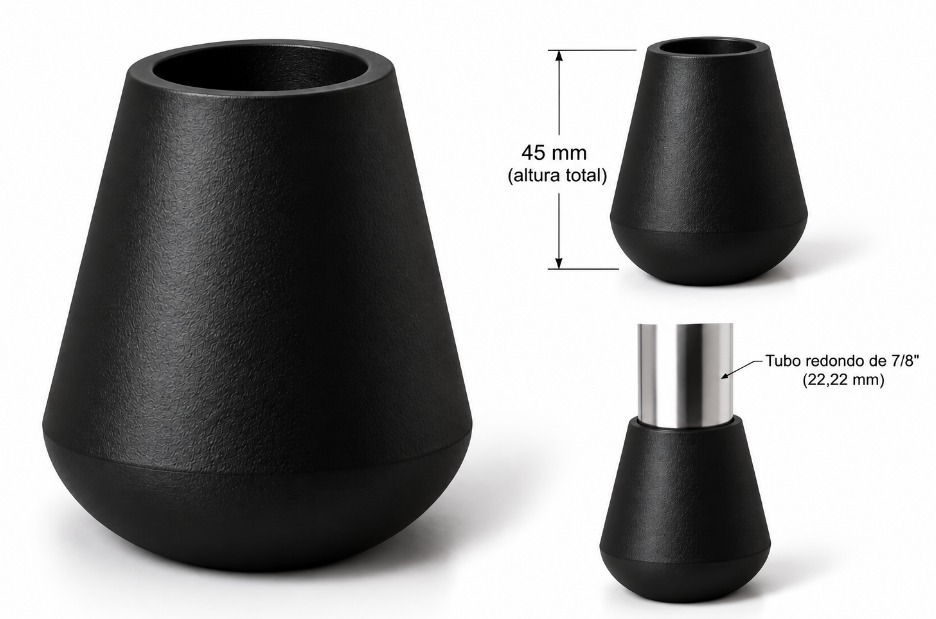
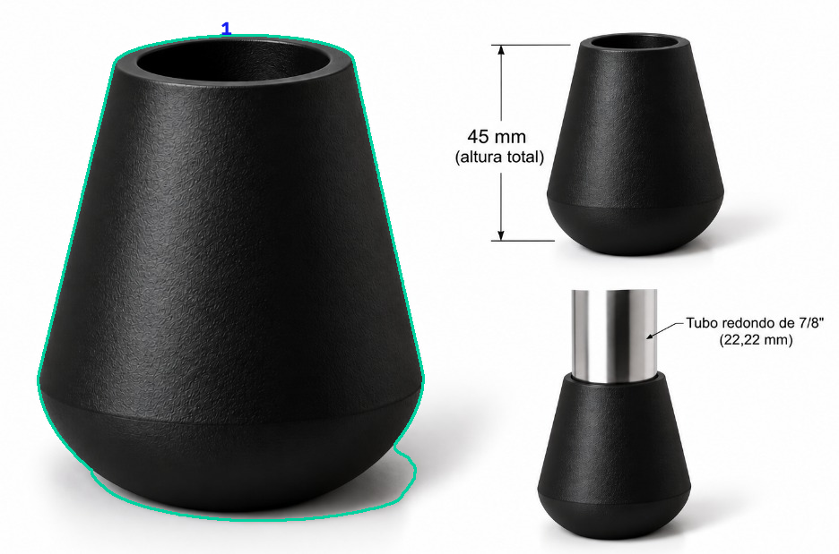
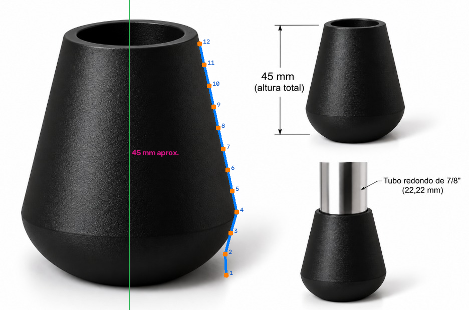
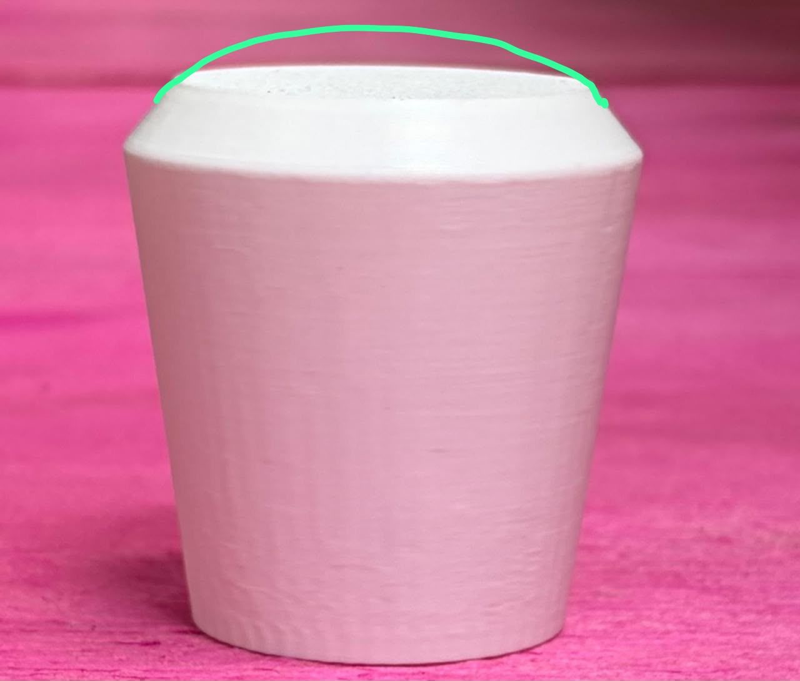
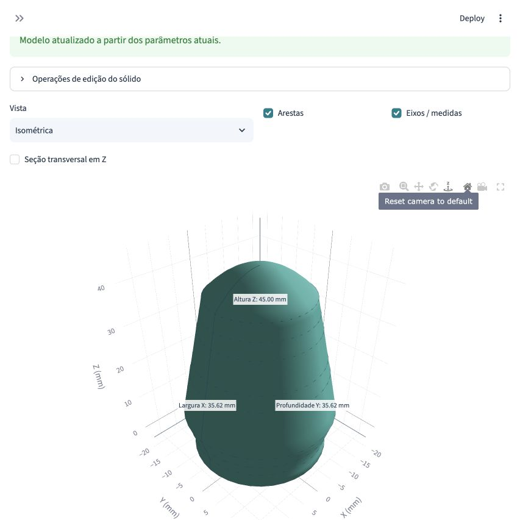

# Contorno CAD - User Manual

Version 0.2.1 | English edition | 1 November 2026

A practical guide to installing the application, turning a photograph into an editable profile, constructing a real CAD solid, modifying it and exporting validated files.

## 1. What the application does

Contorno CAD is a local Python/Streamlit application for assisted reconstruction of physical products. OpenCV processes an image; you review its outline and supply known measurements. CadQuery and OpenCascade turn the edited profile or primitive parameters into actual solid geometry. The 3D viewer displays that geometry interactively.

A **CAD engine** is the part that computes geometric curves, surfaces, solids and operations such as holes, fillets and boolean subtraction. Here, CadQuery provides Python modeling commands and OpenCascade performs the underlying geometry calculations. A viewer alone does not create a CAD solid.

A single photograph does not reveal hidden surfaces, depth, internal cavities or exact scale. Calibration supplies a scale, not perspective correction. Keep unmeasured dimensions identified as assumptions and verify the physical part before manufacturing.

## 2. Install and start on a Mac

The tested platform is Apple Silicon macOS with Python 3.12.14. The pinned ARM wheels require macOS 14 or newer. Windows, Linux and Intel Macs have not been validated. Use a dedicated virtual environment; do not replace another application's environment or `app.py`.

Download the repository using **Code -> Download ZIP**, extract it and open Terminal in its root folder, or use:

```bash
git clone https://github.com/felipe-maia-vassalo/contorno-cad.git
cd contorno-cad
python3.12 -m venv .venv
source .venv/bin/activate
python -m pip install -r requirements.txt
python scripts/preparar_casadi.py
python scripts/preparar_casadi.py --verificar
python -m streamlit run iniciar_cad.py
```

The CasADi preparation step is mandatory. It removes optional solver components excluded by the license audit and verifies the retained CAD runtime. Run it again after reinstalling dependencies. It operates inside this dedicated environment, not global Python. See the license report before distributing dependency binaries.

Open the URL printed in Terminal, normally `http://127.0.0.1:8501`. The line saying the app is available means the server is running; the terminal stays occupied while it serves the app. You do not need to enter another command there. Keep Terminal open. Press Ctrl+C to stop.

On later days:

```bash
cd /path/to/contorno-cad
source .venv/bin/activate
python -m streamlit run iniciar_cad.py
```

`bash executar_macos.sh` is also available. If the port is busy, append `--server.port 8502` to the Streamlit command. An optional Watchdog performance suggestion is not an application failure.

## 3. Language, navigation and saving

The app opens in **English (EN)**. **Language / Idioma** at the top also offers Portuguese. Switching languages preserves project geometry, dimensions, coordinates and pending point/calibration edits. User-entered names are not translated. Existing JSON projects remain compatible; schema keys, source images and legacy filenames may contain Portuguese.

The sidebar's **Workflow** connects Home, Image to CAD, 2D Profile Editor, CAD Editor, Import 3D Model, 3D Viewer and Export Project. These pages share one project in session memory. You do not need to recreate the profile when changing pages.

Use **Save project now** or the JSON download in Export Project before closing/restarting. To resume, choose the JSON in **Reopen project JSON**, click **Reopen saved project**, and generate the model again. A project ZIP must be extracted first; reopen the JSON inside. STL/STEP do not replace the full project JSON.

## 4. First model using the included end cap

1. On Home, click **Open calibrated end cap example**.
2. Open Image to CAD and inspect the actual reference photograph, detected outline and calibration.
3. Visit 2D Profile Editor. Review radius/height coordinates and the curve overlay.
4. In CAD Editor, use **End cap - revolution with spline dome** (the displayed separator may be a bullet), then **Generate / update model**.
5. Rotate the solid, zoom with the wheel and pan with Shift + drag. Inspect front, side, top and isometric views.
6. Change **Dome rise (mm)** from 6 to 9 and generate again. Total height changes from 45 to 48 mm. The model is rebuilt, not merely resized in a picture.
7. Set the measured socket diameter/depth, inspect the section and regenerate.
8. In Export Project, click **Validate geometry and prepare files**, then download the eligible outputs and save JSON.



The example uses an approximately 45 mm calibration reference, a 39 mm side height, assumed 6 mm dome rise and assumed 30 mm socket depth. The socket opens at the reconstructed model's base. The side's radii come from the calibrated silhouette; its vertical span is remapped to the chosen side height. The black photo does not directly show the proposed dome in that orientation. This is assisted reconstruction with explicit choices.

The baseline CAD volume is 18,503.48289166 mm³; the modified model is 19,144.32945587 mm³. Both were actually exported and reimported as STL/STEP. This establishes a real geometry change, not manufacturing accuracy.

## 5. Prepare and upload your photograph

Use JPG/JPEG/PNG, no more than 30 MB or 24 megapixels. The Image to CAD page includes the following practical guidance:

- Show the complete object with a margin around it, in sharp focus.
- Use a simple contrasting background and even light.
- Avoid strong shadows, reflections, transparency and overlapping objects.
- Position the camera perpendicular to the profile being reconstructed.
- Measure a distance in the same plane, or include a usable ruler/reference.
- Use a side view for axial revolution; use a perpendicular face view for constant-depth extrusion.

A clear image with at least roughly 500 pixels along the object's larger dimension is a practical starting point, not a precision guarantee. Oblique views and organic shapes may require additional images, measurements and manual reconstruction.

Choose your file on Image to CAD. The app confirms filename and pixel resolution and displays the original. Physical dimensions remain unknown until calibration. If the image cannot be decoded or exceeds limits, use an original supported file at a reasonable size.

## 6. Detect and correct the contour

1. Adjust horizontal/vertical crop to isolate the object while keeping the intended boundary.
2. Adjust contrast and Gaussian filtering as necessary.
3. Choose **Dark object** for a dark part on a light background, **Light object** for the reverse, **Colored background** for a low-saturation object on a colored background, or **Canny** for edges.
4. Adjust thresholds, gap closing and minimum contour area. A zero threshold enables Otsu in the relevant light/dark methods.
5. Compare the original image, numbered outlines and processed mask. Select the intended contour from the list.
6. Use **Use closed outline (extrusion)** for a planar closed section or **Use right side (revolution / end cap)** for an axial side profile.
7. Review every sampled point. Automatic symmetry and axis suggestions can be wrong with perspective/shadows.



If detection fails, use the photo point editor to add a manual outline. Select/drag points, add or remove points, or clear and redraw. Point order matters. Click **Apply points to step** to commit edits. The canvas displays the control polygon; the CAD curve overlay shows actual computed line/arc/spline segments.

## 7. Calibrate pixels to millimeters

1. In the point editor, choose **Mark two calibration points**.
2. Click the endpoints of a distance you physically know, then apply the points. You can also enter their pixel coordinates numerically or start with contour endpoints.
3. Enter **Known distance (mm)**.
4. Review **Axis / origin X (px)** and **Base / origin Y (px)**.
5. Click **Confirm calibration and convert profile to mm**.

Scale = known millimeters / pixel distance. In the black example, 45/542 = 0.0830258303 mm/pixel. Coincident points or nonpositive distances are invalid. The app works in mm; convert centimeters/inches yourself. For revolution, X is radius, not diameter; Y is height. Calibration does not eliminate perspective or depth errors.

## 8. Edit the 2D profile

Use the numerical table to move points precisely or add/remove rows, then **Apply profile coordinates**. You may also correct points over the photograph. Save JSON before major changes; there is no general undo stack.

- **Line:** straight segment arriving at the point.
- **Arc:** three-point circular arc; supply the intermediate coordinates in mm.
- **Spline:** smooth interpolated sequence through consecutive points. The first spline sequence can receive start/end tangent directions.
- **Smooth side:** PCHIP resampling produces 16 spline points from at least three distinct heights; it is intended for a side profile rather than every closed outline.



Tangency controls are not a full constraint solver. Crossings, repeated/invalid points, incompatible arcs or negative revolution radii can prevent construction. Correct the coordinates rather than forcing an invalid solid.

## 9. Choose a reconstruction method

**End cap with spline dome:** set side height, dome rise and shape. Custom normalized dome controls allow a variable-radius curve. Endpoints connect shoulder and axis; the apex has a horizontal tangent. Controls must remain ordered and within the permitted range. The base socket uses inner diameter and depth. The wall helper specifies thickness at the base only; it is not a uniform shell.



The demonstration extracts four normalized controls from the green mark; its assumed 45 mm scale is independent of the black photograph. In the app, dome controls can be edited numerically. No external diameter is claimed as an exact measurement.

**General revolution:** revolve a suitable profile 360 degrees around the axis. Keep all radii nonnegative. A side can close to the axis; a closed annular section can describe a hollow part.

**Extrusion:** supply a closed contour and positive depth. The section remains constant through that depth; a photograph does not supply depth automatically.

**Assisted reconstruction:** combine boxes/plates, cylinders, tubes and a two-circle loft with dimensions and position. Add material first, then union/subtract shapes. More detailed existing-shape editing may require JSON. Arbitrary organic reconstruction is outside scope.

## 10. Edit and inspect the solid

After a change, use **Generate / update model**. Stale geometry is blocked from export until regenerated. Failed operations display an explanation and do not silently become a successful new model.

The CAD operation controls include fillet/chamfer, positioned cylindrical holes, rectangular cavities, box union/subtraction and uniform scale. Fillet/chamfer edge groups are selected by top/bottom/vertical/all criteria; there is no mouse face/edge picker. Holes run along global Z from top or base. The operation list can remove the last operation or be edited numerically as JSON.

Excessive fillets, intersecting profiles or a socket breaking through the wall can fail. Reduce the feature size or correct the geometry. Nominal 22.22 mm does not establish clearance, shrinkage or fit; measure the actual tube/part.

Use the viewer's camera presets, axes, overall bounds and edge display. The Z section shows intersection lines between the display mesh and a horizontal plane; it does not cut the CAD solid. There is no arbitrary oriented analytical section, point-to-point dimension tool or structural analysis.



## 11. Import existing 3D models

On Import 3D Model, upload a supported intermediate file. In SketchUp, inspect the export formats offered by your edition/version; choose a supported format. This app has no native SKP reader and does not change SketchUp licensing/export availability.

| Format | What can be edited |
|---|---|
| STEP/STP | Valid closed CAD solids; transforms and compatible solid operations, without original history. |
| STL/OBJ | Meshes; inspect, select available components, translate, rotate and scale. |
| GLB | Mesh scene instances; component transforms applied on import. |
| GLTF | Embedded resources only; prefer GLB for portability. |
| DAE | Optional reader not installed/audited/validated by default. |

Select the **active component**, confirm units, apply uniform scale, X/Y/Z rotations and translation. Scale and rotation are about the global origin, followed by translation. Only that active component is displayed/exported. Other components remain in the stored original source; this is not full assembly editing. An imported mesh does not become a parametric solid merely by loading it.

The included two-component GLB/OBJ demonstration is generated by this app, not exported during a real SketchUp session. Use imported geometry as a reference for manual reconstruction when direct feature editing is unavailable.

## 12. Validate, export and reopen

In Export Project, save JSON and click **Validate geometry and prepare files**. Download buttons are offered only for the appropriate representation/checks.

| Output | Content and checks |
|---|---|
| STL | Triangulated geometry; reimport checks closure, consistent winding and positive volume. |
| STEP | Actual eligible CAD solids; reimport checks validity, solid count, bounds and volume. |
| HTML | Standalone interactive preview with Plotly.js embedded; no CDN required. |
| JSON | Full application parameters/profile/calibration and image/import bytes. |
| Report | Numerical geometry checks; schema keys remain stable for compatibility. |
| ZIP | Collected validated project outputs; extract JSON to reopen. |

CAD tessellation can contain zero-area/duplicate pole triangles. Normalization only removes those while preserving bounds/volume and logging counts. It does not repair holes, reverse faces or move vertices; imported meshes are not silently repaired. STEP is not offered for meshes as if they were CAD solids.

If you switch language after preparing HTML, prepare the export again to get labels in the selected language. User data, schema keys and legacy filenames remain unchanged. Valid geometry is not a manufacturing approval.

## 13. Troubleshooting and evidence

| Problem | Next step |
|---|---|
| Server started but no window | Open the printed local URL while leaving Terminal running. |
| Command not found | Activate `.venv` or use `python -m streamlit`. |
| Runtime preparation error | Use the dedicated Python 3.12 environment, reinstall requirements if necessary and rerun preparation. |
| Incorrect outline | Crop and adjust detection; select another contour or draw manually. |
| Wrong size | Check known distance, pixel endpoints, radius versus diameter and perspective. |
| Model fails | Check point order, intersections, nonnegative radii and feature sizes. |
| Socket breaks through | Reduce bore/depth or increase measured body dimensions. |
| Old model unavailable after edit | Regenerate successfully before exporting. |
| JSON restored but no solid | Generate again; JSON stores construction data. |

Automated tests execute real JPEG processing, CAD generation/modification, valid STL/STEP round trips, imports, save/reopen and language changes. Historical Portuguese browser captures are retained without relabeling; calculated OpenCV images are explicitly identified. Automated checks do not establish every browser gesture or physical measurement.

For detailed scope, see `docs/FUNCIONALIDADES_E_LIMITACOES.md`; for installation/deployment, see `docs/IMPLANTACAO.md`; for licenses, see `docs/LICENCAS.md` and `THIRD_PARTY_NOTICES.md`. The code is MIT; source photographs and third-party packages have separate rights. No university endorsement or validated manufacturing certification is implied.
